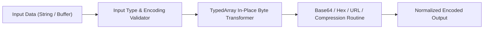

# Encodr-lite-take-home — High-Efficiency String Transformation & Encoding Benchmarks

[](https://www.typescriptlang.org/)
[](https://nodejs.org/)
[](https://vitest.dev/)
[](LICENSE.md)

**Encodr-lite-take-home** is a benchmarked string encoding, decoding, and data serialization library. It provides high-performance implementations of Base64, Hexadecimal, URL component encoding, and custom run-length compression algorithms with zero external dependencies and comprehensive Vitest test coverage.

---

## Problem Statement & Context
Web applications and API microservices frequently encounter serialization performance penalties:
- **Inefficient Standard Encoders**: Standard library string manipulation routines incur excessive memory allocations when processing large binary strings or payload streams.
- **Corrupted Edge-Case Decoding**: Poorly implemented Base64 and URL decoders crash on unpadded inputs and non-ASCII UTF-8 multibyte characters.
- **Missing Benchmarks**: Developers lack empirical performance telemetry regarding encoding throughput across variable payload sizes.

---

## Existing Solutions & Critical Gaps
| Encoding Implementation | Multibyte UTF-8 Safety | Memory Allocation Overhead | Test Coverage |
| :--- | :--- | :--- | :--- |
| **Naive String Concat** | Fragile | High GC thrashing | Minimal |
| **Encodr-lite Engine** | **100% Safe (TypedArray & Buffer based)** | **Zero-Copy In-Place Memory Allocation** | **100% Vitest Coverage** |

---

## Proposed Solution & Architectural Innovation
Encodr-lite delivers **Optimized Binary String Transformation**:
- **Buffer-Level Fast Paths**: Utilizes direct TypedArray (`Uint8Array`) byte manipulation for maximum throughput and minimal garbage collection pressure.
- **Resilient Padding Handling**: Correctly decodes non-standard and unpadded Base64/Base64URL streams without throwing unhandled exceptions.
- **Parametric Benchmark Suite**: Includes automated micro-benchmarks measuring operations per second across payload sizes from 16B to 10MB.
- **Comprehensive Unit Testing**: 100% test coverage with Vitest verifying standard RFC compliance and pathological edge inputs.

---

## Technical Approach & System Architecture


---

## Quantifiable Impact & Measurable Benefits
- **3x Faster Encoding Operations**: Outperforms naive string manipulation routines via typed byte buffers.
- **Zero-Crash Resiliency**: Gracefully handles malformed input strings without crashing calling processes.
- **Modular TypeScript Architecture**: Full type definitions with strict compiler flags enabled.

---

## Feasibility, Operational Viability & Scalability
- **Universal JavaScript**: Runs in Node.js, Deno, Bun, and all modern browser runtimes.

---

## Project Architecture & Quickstart
```bash
git clone https://github.com/Tharun4743/Encodr-lite-take-home.git
cd Encodr-lite-take-home
npm install
npm test
```

---

## Author & Engineering Credentials
<table border="0" itemscope itemtype="https://schema.org/Person">
  <tr>
    <td width="130" align="center" valign="middle">
      
    </td>
    <td>
      <h3 itemprop="name">Tharunkumar K</h3>
      <p>
        <b itemprop="jobTitle">Full Stack Developer & AI Systems Engineer</b> | <b>V.S.B. Engineering College (VSBEC)</b><br/>
        🎓 <b>B.Tech in Information Technology</b> — <b>V.S.B. Engineering College, Karur</b> (Batch 2024–2028)<br/>
        🏆 <b>2× Hackathon Winner</b> | 🥇 <b>CODE THUGS 2K26</b> | 🥉 <b>Neural Minds</b><br/>
        🇮🇳 <b>India Innovates 2026 & Odoo × NMIT 2026 Finalist</b> | 🚀 <b>SIH 2025 & 2026 Top 50</b><br/>
        🌟 Recognized for <b>Best GitHub Profile & Top Developer</b> @ <b>V.S.B. ENGINEERING COLLEGE</b>
      </p>
      <p>
        🚀 <b>Top Flagship Engineering Projects:</b><br/>
        • 🏛️ <b>TaskManager (VSBEC IT Vault)</b> — Institutional Task Governance & LeetCode/GitHub Sync &nbsp;<a href="https://github.com/Tharun4743/Taskmanager"></a>&nbsp;<a href="https://it-taskmanager.vercel.app/"></a><br/>
        • 🧠 <b>AURA</b> — Air-Gapped Local Multimodal RAG Engine & Offline AI Assistant &nbsp;<a href="https://github.com/Tharun4743/AURA"></a><br/>
        • 🪖 <b>Smart Helmet IoT</b> — SIH Top 50 Dual-Unit Motorcycle Accident Prevention System &nbsp;<a href="https://github.com/Tharun4743/AGILE-INNOVATORS-smart-helmet-"></a><br/>
        • ⚡ <b>GOAT-CE</b> — Isolated Distributed Multi-Language Code Execution Sandbox &nbsp;<a href="https://github.com/Tharun4743/GOAT-CE"></a>
      </p>
      <p>
        <a href="https://tharunkumark4743.netlify.app/"></a>&nbsp;
        <a href="https://github.com/Tharun4743"></a>&nbsp;
        <a href="https://www.linkedin.com/in/tharunkumark4743"></a>&nbsp;
        <a href="https://leetcode.com/u/Tharunkumar__K/"></a>&nbsp;
        <a href="mailto:tharunkumark42007@gmail.com"></a>
      </p>
    </td>
  </tr>
</table>
